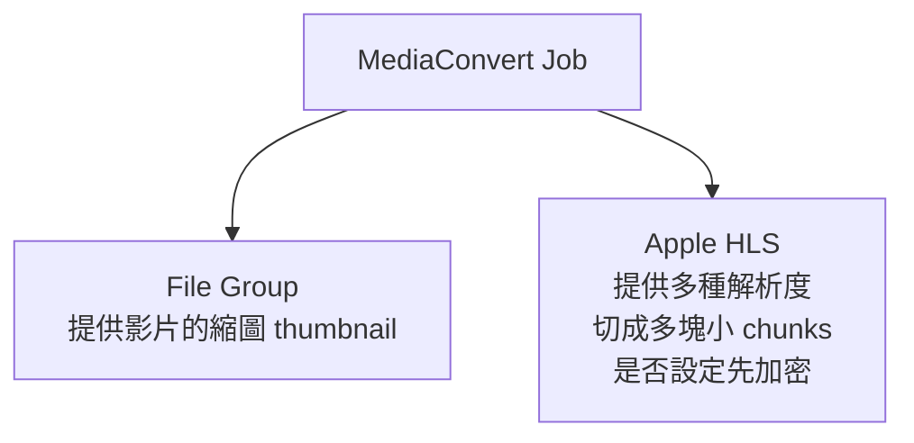
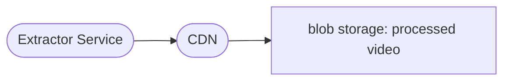
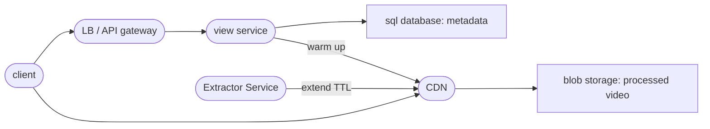
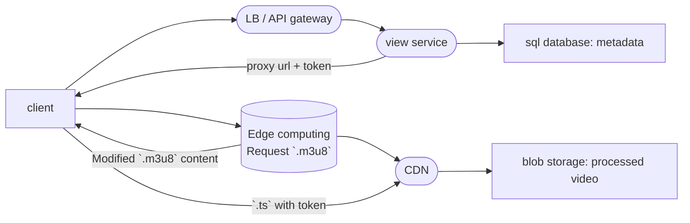

<!--BODY-->
> 由於 Video streaming 是會消耗大量頻寬，用戶又對延遲敏感，故為了達到比較流暢的觀看體驗，主要會討論:
> - [**Streaming protocol**](https://aryido.github.io/posts/video-streaming/knowledge/) : 如 HLS、DASH 這些 **Adaptive bitrate streaming(ABS)**，允許 player 不需要等待整個影片下載完成才播放，而是可以同時下載多個「影片小片段」，這時就可以開始觀看，並且根據即時網路狀況和裝置功能動態地在品質等級之間切換
> - **CDN** : 絕大多數視訊流量由靠近用戶的 CDN 邊緣節點提供服務，這是影響成本和延遲最重要的部分
>
> 最後是關於**串流防盜**，當影片和串流媒體僅依賴 URL 存取時，資料不僅容易拷貝，還容易發生未經授權的觀看分享，尤其是對於付費內容更需要注意，故安全性如何保證也是一個重要的議題。

<!--more-->

---

[承前面文章](https://aryido.github.io/posts/video-streaming/backend/)知道使用者要觀看影片時，其 view flow 的基本流程是： Client 呼叫 view service，會 DB 搜尋對應 video metadata 然後 Server 返回， 而 video player 再來會用前面回傳資料去 blob storage 拿取影片。這種 Data FlowOut 問題，主要都要考慮一下 latency ，在這裏就是考慮「影片播放 latency」該怎麼優化呢？ 基本解法如下：
- 針對影片 protocol 優化
- 針對影片，使用快取優化


# Adaptive bitrate streaming

針對影片本身格式的優化，就是使用 HLS 等 ABS 技術，而為了讓使用者上傳的影片也都支援 ABR 技術，還會需要另外對使用者上傳的影片做轉檔處理，故在 [Video Sharing Platform: 影片上傳技術細節](https://aryido.github.io/posts/video-streaming/backend-upload/)文章中，上傳影片之後有一個 convert pipeline 來達成此目的。實作上可以使用 AWS Elemental MediaConvert 來對影片進行轉碼處理，在 MediaConvert job 定義要做的事情的細節上有：



在播放之前的畫面，需要一個內容的縮圖來顯示，是蠻常前端會提出的需求


經過 MediaConvert 轉檔的流程後，最後生成的 HLS 影片檔儲存在 blob storage 內，假設影片 ID 是 abc123，convert 之後多個檔案大概會是如下關係表示：
```text
abc123.m3u8
 ├─ abc123_480p.m3u8
     ├─ abc123_480p_00001.ts
     └─ abc123_480p_00002.ts
 ├─ abc123_720p.m3u8
    ...
 └─ abc123o_1080p.m3u8
    ...
abc123_thumb.0000000.jpg
```
- HLS 串流的核心檔案就是 `.m3u8 ` ，會告訴播放器有哪些畫質／碼率可選，會列出不同畫質的 Media Playlist 和預估頻寬，以下是範例 :
  ```text
  #EXT-X-STREAM-INF:BANDWIDTH=800000,RESOLUTION=854x480
  video_480p.m3u8

  #EXT-X-STREAM-INF:BANDWIDTH=2500000,RESOLUTION=1280x720
  video_720p.m3u8

  #EXT-X-STREAM-INF:BANDWIDTH=5000000,RESOLUTION=1920x1080
  video_1080p.m3u8
  ```
- 其中子檔案如 `video_XXXp.m3u8` 等，內容會列出該畫質的 `.ts` 分段檔，指向一連串透過標準 HTTP 傳輸的影片片段（segment, chunk）

有了 HLS（HTTP Live Streaming）或 DASH（Dynamic Adaptive Streaming over HTTP）等 streaming protocol，影片便可快速且自適應地提供服務，使得播放更順暢。


幾乎所有 on-demand video streaming 的巨頭服務商，都有使用 Adaptive bitrate streaming（ABS）技術


# CDN

影片串流播放並不需要複雜的計算資源，故幾乎不耗費 CPU 運算效能，但它需要**大量的網路頻寬**，故就算 auto-scale 後端 server 也只是增加 CPU/Memory ，對影片串流播放的 latency 並沒有太大作用，公認正確的做法是後端伺服器應該完全從影片串流播放這個重活內解放出來，**API 伺服器不應該搬運串流媒體檔案**，這件事讓 CDN 來負責。

為了進一步增加影片流暢度，[主流速度優化方案就是引入 CDN](https://hackmd.io/@kaeteyaruyo/computer-networking-2-6)，可顯著降低 latency，但會產生額外的 cost 。對於影片 cache 的管理，可以另外做個 Extractor Service 把熱門影片找出來，讓 CDN 裡維持最高利用率 ; Extractor 還可以套用一些 ML 模型來計算熱門影片，進一步展開到推薦系統等等。


### Thundering Herd Problem
再進一步可以討論「驚群效應(Thundering Herd Problem)」，這種現像在實際場景中並不少見，例如：
- 多個 instance 同時宕機，所有流量被重定向到少數存活的實例上
- 影片突然爆火，帶來大量訪問， 但 CDN 根本還沒有快取
- 快取擊穿(Cache Stampede)，熱門資料過期，超多請求同時打向資料庫
- 重試風暴(Retry Storm)：服務短暫中斷後恢復，所有客戶端在同一秒進行重試

這類由於突發流量激增而造成的系統雪崩式故障，就是所謂的 Thundering Herd Problem。架構上目前是 client 會向 CDN 請求影片， CDN 如果沒有就自動回去 blob storage 抓取之後快取起來再回傳給 client，但如果影片爆火，全球CDN 節點同時發現自己沒有這影片，然後同時很多全都回頭去 blob storage 讀資料，也可能會導致系統出問題。

Amazon S3 每秒可實現 `3500` 個 `PUT/COPY/POST/DELETE` 請求和 `5500` 個 `GET/HEAD` 請求


解決方式是做「**CDN 預推送**」，可以在 view service 的內維護一個即時的熱度地圖，每次有用戶請求 video 就在計數器上加 1，當某 video 請求速度超過一個預設的門檻(比如說十秒內被請求了一千次)，就判斷這 video 要爆了，這時 view service 主動去呼叫 CDN 供應商的介面，先去 blob storage 把 video 拉下來，這裏可以選擇：
- 等到 CDN 確認預熱到全球每一個節點之後，view service 才返回 url
- 加一個隨機抖動（Jitter）時間後， view service 才返回 url，延長回覆時間給 CDN 預熱



這個做法的代價是： 熱度地圖可能誤判會白花了一些儲存成本，且第一批用戶在預熱完成之前可能要多等一下。

---

# 觀看影片的權限設計
為了保護影片未經授權被觀看和盜連，常用做法是配置 token authentication ，針對每個影片觀看請求，產生一串短效且唯一的字串（Token），該 Token 會在影片播放開始之前進行驗證。這裏引出 Token 的設計和實作。 而不論生成還是解析 Token ，在自己後端 server 上達成是常見的方式，但還有其他的選擇可以考慮，例如說使用偏向 cloud infra 的解決方案:
- 「Edge Computing 邊緣計算」來生成或解析 Token
- 「WAF 防火牆」解析驗證 Token 

實際舉例來說，[使用 Cloudflare Worker 和 Cloudflare Custom rules 可以達到上述要求](https://developers.cloudflare.com/waf/custom-rules/use-cases/configure-token-authentication/)，可參考此文檔來做。

### HMAC Token 生成和解析

**HMAC Token 的生成**可以是自家的後端 server，或者使用邊緣計算行，但應該大部分還是以自家的後端 server 為主，因為要生成 Token 時蠻大機率也會需要對 user 身份做確認，在自家後端做 DB 查詢一定比較方便。 

既然要使用 HMAC Token 來保護影片資源，就會需要設定「目標 asset」、 「timestamp」、「Token secret key」等等，其中可以注意一下：
-  [Cloudflare 使用 HMAC Token 也能一次保護多個 asset ](https://developers.cloudflare.com/waf/custom-rules/use-cases/configure-token-authentication/#protect-several-paths-using-the-same-secret)

- 產生一個「臨時的唯一令牌」，Token 的有效時間不要設定太長。
  
  更進一步地還可以為 Token 綁定使用者的特定資訊，不讓任何拿到連結的人都能播放，例如說將 Token 綁定使用者裝置，同一個連結在不同裝置上使用就會失敗。
  

- Token secret key 一定要保護好

至於 **HMAC Token 解析認證**應該在哪裡做，就有蠻多種選擇，除了寫 code 在自家的後端 server 來判定之外
- 使用 Cloudflare Worker 來做驗證判斷
- 在 Cloudflare custom rules 防火牆機制上，利用便利的 [`is_timed_hmac_valid_v0()` HMAC 驗證函數](https://developers.cloudflare.com/ruleset-engine/rules-language/functions/#hmac-validation)，可直接解析 url 附帶的 token 是否合規

接下來就再詳細說明串流安全的一些實作核心：

# 串流安全實作

如何防止媒體資源的非授權存取是一個課題，由於 HLS 核心是一個叫做 `.m3u8` 的播放清單檔案，故只要有 `.m3u8`，就能直接請求背後的所有影片片段，所以思考串流資料安全性時，需要考慮多個檔案的存取性的。以下提供一些實作方式，主要會用前面提到的 HMAC Token 和使用 Cloudflare 的功能：

### 使用 HMAC Token 保護所有 HLS 相關檔案

在影片上傳流程中，使用者的影片會被 MediaConvert 轉檔，產生一系列 `.m3u8` 和 `.ts` 檔案。同一個影片產生的 HLS 檔案集，這些都會儲存在 blob storage 同一個 folder 下 ; 不同影片會在不同 folder，可以由 `video_id` 來標示 folder 。接著我們定義 Cloudflare custom rules 阻擋規則，所有 HLS 檔案都必須要附帶 token 才可以取得 ; 且因為一個影片的 HLS 檔案集 都是在同一個 folder 下，[**可以把相同 folder 下檔案所需的 HMAC token 定為同一個**](https://developers.cloudflare.com/waf/custom-rules/use-cases/configure-token-authentication/#protect-several-paths-using-the-same-secret)，這樣方便不少。

雖然影片所有相關檔案都被 custom rules 阻擋規則保護了，但也產生了一些問題 ！ 因為影片觀看的程式流程，是 Client 會用 `video_id` 向 view service 請求 `.m3u8` 索引檔案，video player 拿到 `.m3u8` 之後會「**根據裡面內容**」，請求 `.m3u8` 或 `.ts` 檔，但由於 MediaConvert 轉碼後 `.m3u8` **裡面內容就固定**了（代表裡面針對 `.ts` 的 url 都沒有附加 token，這樣 player 是無法存取分片檔的)，故:

> 要思考怎麼讓 `.m3u8` 檔的內容可以動態改變，在這裡是指如何讓 `.m3u8` 檔內容的請求片段，都附加上正確的 HMAC Token

常用做法是使用「邊緣節點」動態注入權限憑證，可以選擇 「cloudflare worker」 或者是 「AWS Lambda@Edge」 來實作。處理資料流如下：
- client 用 `video_id` 向 view service 請求，後端服務校驗權限並產生 token，回傳一個帶有 token 的 「proxy url」
- proxy url 指向 「邊緣節點」， 在這裡才真正用 `video_id` 請求 `.m3u8` 檔案，然後在程式內改寫檔案內容，把 token 都附加上去，回傳改寫過後的 `.m3u8`
- client 拿到這個改寫過的 `.m3u8` 檔案，由於裡面 `.ts` url 都附上了 token 所以在期限內可以正常取得影片片段



##### Elemental MediaConvert 配置 HLS 標準加密

HLS 標準加密採用 AES-128 演算法將 `.ts` 切片加密， video player 需取得 key 才能解密播放。做法是在 Elemental MediaConvert job 附上加密相關配置就可以達成。加密後的 `.m3u8` 文件內容，會有例如：
```text
#EXT-X-KEY:METHOD=AES-128,URI="https://DOMAIN/enc.key",IV=0x00000000000000000000000000000001
```
這個內容片段，而 video player 會依照 `EXT-X-KEY` 標籤來請求密鑰。

HLS 切片加密後，在沒有 key 的情況下將無法正常播放影片文件，因此 key 的存取保護尤其重要， 所以 key 的存取當然也是需要權限驗證的，同理可用 HMAC Token 保護。由於 MediaConvert 轉碼後 `.m3u8` 內容的 key url 就固定了，而接下來也是思考如何把 Token 附加到 m3u8 檔案中的金鑰 URL 中，常用解法也是使用「邊緣節點」動態注入。

### [DRM Protection](https://www.servermania.com/kb/articles/how-to-set-up-secure-token-authentication)

Digital Rights Management (DRM) 與 Token authentication 結合使用是目前網路上傳輸數位內容最安全的方式。常見的 DRM 協定包括 `Google: Widevine` 、 `Apple: FairPlay` 和 `Microsoft: PlayReady` ，每種協定都有其自身的裝置生態系統和播放規則，有需要做到這樣的安全性再來展開吧。


---

# 排行榜
可以思考一下，假如每天要處理幾百萬次播放紀錄，那怎麼能即時看當下最熱門的前 100 的影片呢？

首先最簡單想法是靠關聯式資料庫，每次影片播放完畢就寫一筆紀錄到資料庫，紀錄某用戶在某時間播放了某影片。當要看熱門排行榜時就去資料庫查詢，例如把過去一小時的所有播放紀錄撈出來，按影片分組計算次數從高到低排序，取前一百名。這在小規模的時候完全沒問題，但要處理每天幾百萬次播放紀錄，等於每秒鐘約幾十次紀錄寫入，**在一個經常性寫入新資料的資料表上跑排序查詢，資料庫是會有效能問題的**。

解法上，基本要完全放棄用戶請求時才計算這種思路，需改成**資料流進來的之前就預先計算好**！考慮到是這種綿延不斷的事件寫入，故能使用訊息佇列系統，把每秒接收到的事件放入佇列中，讓後面的多個 server 來對影片計算播放次數。這邊有一個關鍵的設計決策： 如果隨機把「播放影片的事件」分配給不同的伺服器 server ，例如：server1 可能收到一個 video1 的播放 ，而 server2 也收到一個 video1，那這樣要計算 count 還要再聚和多個 server 的資料，會有蠻多問題且讓回應時間增加。故解法應該是把同一個 video 事件都送到同一台 server 才對，雖然可能會有熱點的問題，但是這裡還是以 latency 為主要考量。

而每台 server 把自己負責的影片計數存在記憶體裡取前一百名，這裡可以用到一個 Heap 的資料結構，size 做限定 100 ，最後把多台 server 自己的本地前一百名清單送到一個中央 aggregation server 把所有清單合併，算出真正的前一百名，然後把結果寫進如 Redis 裏面，這樣是把答案提前算好放在快取裡等來取


---

### 參考資料

- [High Level Design for a video streaming platform like Netflix or Hotstar (Part — 1)](https://levelup.gitconnected.com/high-level-design-for-a-video-streaming-platform-like-netflix-or-hotstar-part-1-159db2a3ca5d)

- [Designing a Scalable Video Platform Like YouTube — A Modern System Design Deep Dive](https://medium.com/@harshithgowdakt/designing-a-scalable-video-platform-like-youtube-a-modern-system-design-deep-dive-0212873d06d6)

- [用亞馬遜雲端科技 Elemental MediaConvert 實現 HLS 標準加密](https://aws.amazon.com/cn/blogs/china/use-aws-elemental-mediaconvert-to-achieve-hls-standard-encryption/)

- [MediaConvert HLS 加密實戰：Lambda@Edge 動態金鑰驗證方案](https://aws51.com/%E4%BD%BF%E7%94%A8%E4%BA%9A%E9%A9%AC%E9%80%8A%E4%BA%91%E7%A7%91%E6%8A%80-elemental-mediaconvert-%E5%AE%9E%E7%8E%B0-hls-%E6%A0%87%E5%87%86%E5%8A%A0%E5%AF%86/)

- [EP344 系統設計懶懶學 - Spotify 推薦系統背後的架構大拆解：從 1.5 PB 音檔儲存到毫秒級反應，教你如何設計支撐億級用戶的系統](https://www.youtube.com/watch?v=b6BANKLA_Ew)
